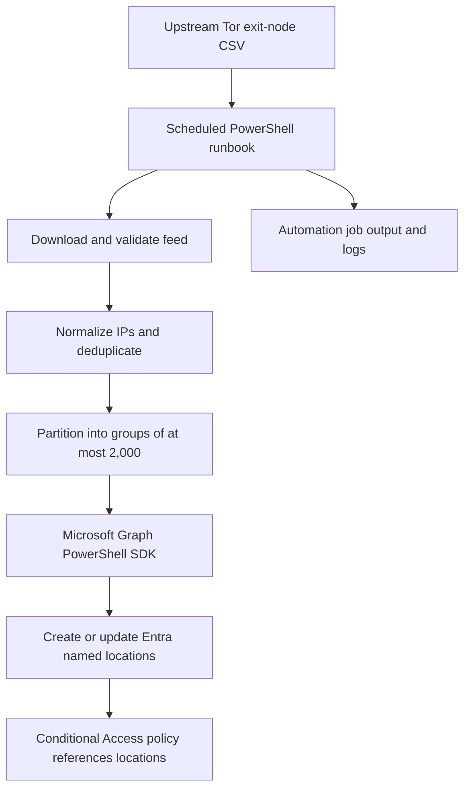

# Architecture

## Trust boundaries

- The upstream CSV is external, untrusted input.
- The runbook validates structure and addresses before making changes.
- The managed identity is privileged to write Conditional Access named locations.
- The runbook does not create or edit Conditional Access policies.

## Failure handling

The runbook stops before writes when the feed cannot be retrieved, required CSV structure is missing, the valid address count is below the configured minimum, or the configured change threshold is exceeded. A Graph failure can still occur partway through multiple location updates; inspect job output and rerun after resolving the cause. The operation is designed to be idempotent, so reruns converge toward the desired state.
